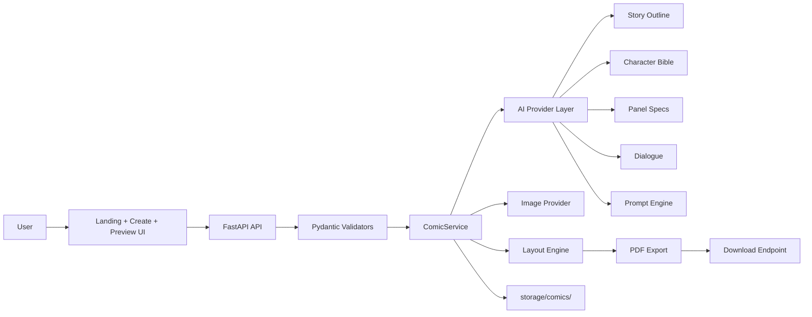

# ComicCraft

ComicCraft is a FastAPI-based AI comic generation studio that turns a short idea into a structured comic with characters, panel scenes, AI-generated image prompts, layout generation, speech bubbles, and a downloadable PDF.

## Overview

The app is designed for creators who want to go from story concept to finished digital comic without juggling separate tools. It combines:

- a guided comic creation form
- Pydantic validation on both the frontend request and backend schema
- AI workflow stages for story, character, panel, dialogue, and image prompt generation
- mock providers for local development and CI
- a real Gemini provider abstraction for production integrations
- layout, preview, and PDF export features
- secure filesystem and path validation

## Features

- Landing page with premium AI-product styling and comic-inspired visuals
- Create Comic form for title, story idea, settings, genre, tone, art style, and panel count
- Background generation jobs with status polling and progress updates
- Story outline generation using structured JSON + Pydantic validation
- Character bible generation with consistent visual identity and palette guidance
- Panel-by-panel scene expansion and dialogue generation
- Prompt engine that avoids sending raw user input directly to the image model
- Image provider abstraction with mock and real implementations
- Layout engine with panel composition and page generation
- Speech bubble rendering system with narration and bubble logic
- PDF generation and download endpoint
- Panel regeneration support without replacing the full comic
- Comprehensive validation for unsafe filenames, path traversal, invalid enums, and excessive input lengths

## Architecture



## Technology Stack

- Python 3.12+
- FastAPI
- Pydantic v2
- Jinja2 templates
- Pillow for image generation mocks
- ReportLab for PDF export
- Pytest for automated tests
- Google Generative AI client for optional Gemini integration
- Docker support for containerized deployment

## AI Workflow

The generation flow is implemented as a staged pipeline:

1. Generate structured story outline
2. Generate character bible
3. Expand into panel-by-panel scenes
4. Generate concise dialogue
5. Generate image prompts from character bible and scene context
6. Generate comic illustrations
7. Build layout pages
8. Render speech bubbles and narration
9. Create final PDF

The workflow uses a background job system so users receive a job ID immediately instead of holding an HTTP request open.

## Project Structure

- app/config.py
- app/main.py
- app/models.py
- app/schemas.py
- app/utils.py
- app/templates/
- app/static/
- tests/
- .env.example
- Dockerfile
- docker-compose.yml
- requirements.txt

## Environment Variables

Create a local .env file based on .env.example:

- APP_NAME
- ENVIRONMENT
- AI_PROVIDER
- IMAGE_PROVIDER
- GEMINI_API_KEY
- GEMINI_MODEL
- MAX_PANEL_COUNT
- MIN_PANEL_COUNT
- STORAGE_DIR
- LOG_LEVEL

The defaults are safe for mock mode and local development. API keys are never exposed to the frontend.

## Installation

```bash
python -m venv .venv
source .venv/bin/activate
pip install -r requirements.txt
```

## Running the app

```bash
python -m uvicorn app.main:app --host 0.0.0.0 --port 8000 --reload
```

Then open:

- http://127.0.0.1:8000/
- http://127.0.0.1:8000/create
- http://127.0.0.1:8000/docs

## Mock mode

Set the following in your environment:

```env
AI_PROVIDER=mock
IMAGE_PROVIDER=mock
```

This lets the application run completely without API keys or paid external services. Mock output is explicitly marked as development output and should not be treated as real AI-generated final art.

## API Documentation

FastAPI exposes automatic OpenAPI docs at:

- /docs
- /redoc

Key endpoints include:

- GET /
- GET /create
- GET /health
- POST /api/comics
- POST /api/comics/generate
- GET /api/comics/{comic_id}
- GET /api/comics/{comic_id}/status
- GET /api/comics/{comic_id}/preview
- POST /api/comics/{comic_id}/regenerate
- POST /api/comics/{comic_id}/panels/{panel_id}/regenerate
- GET /api/comics/{comic_id}/download
- DELETE /api/comics/{comic_id}

## Testing

Run:

```bash
pytest -q
```

The project includes tests for:

- validation
- Pydantic models
- endpoints
- mock AI behavior
- malformed response handling
- path safety
- generation status flow
- PDF and image generation paths

## Docker

```bash
docker build -t comiccraft .
docker run -p 8000:8000 comiccraft
```

Or use:

```bash
docker-compose up --build
```

## Deployment Notes

- Keep secrets in environment variables only
- Do not commit .env files
- Set AI_PROVIDER and IMAGE_PROVIDER explicitly in managed environments
- Use a secure persistent volume for storage/comics

## Limitations

- Real Gemini image generation is implemented but requires a valid API key and service support
- This project uses mock generation outputs for offline local development and tests
- Layout and PDF generation are tuned for a clean, polished default workflow rather than industrial-scale production editing

## Future Improvements

- richer multi-page layout templates
- user editing and revision history
- stronger image inpainting and panel-level refresh options
- real-time WebSocket updates for generation progress
- cloud storage and user authentication
